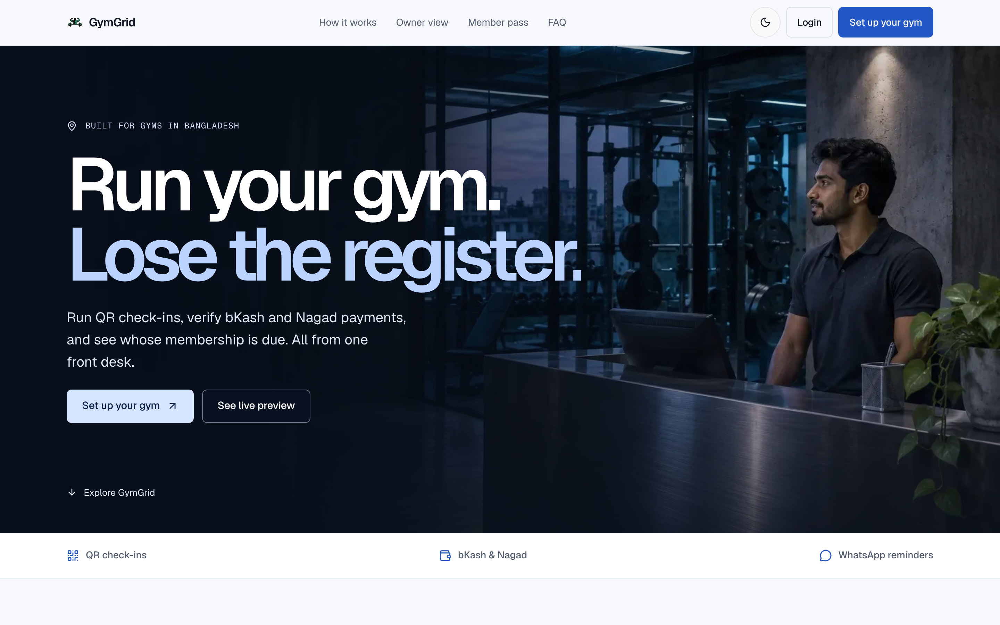
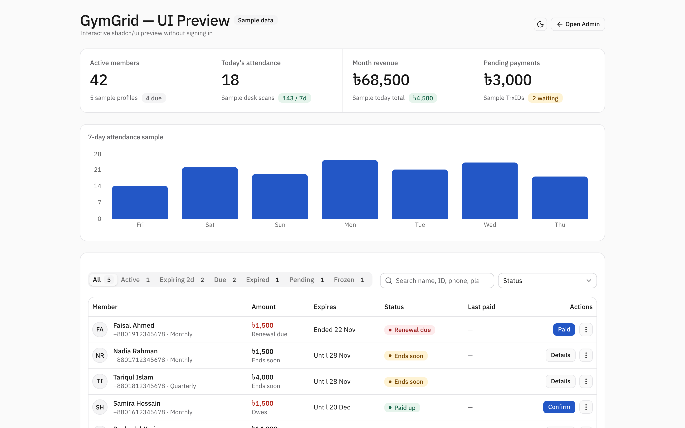
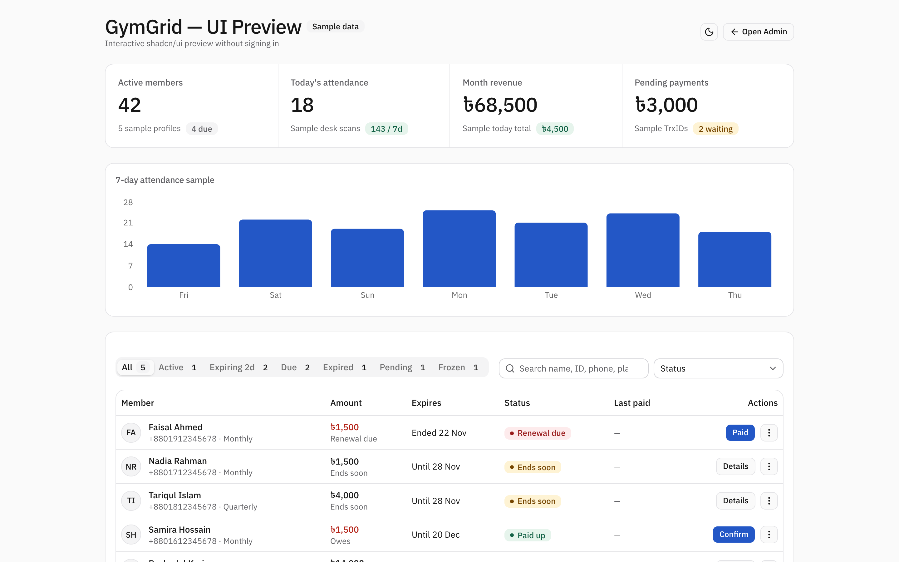
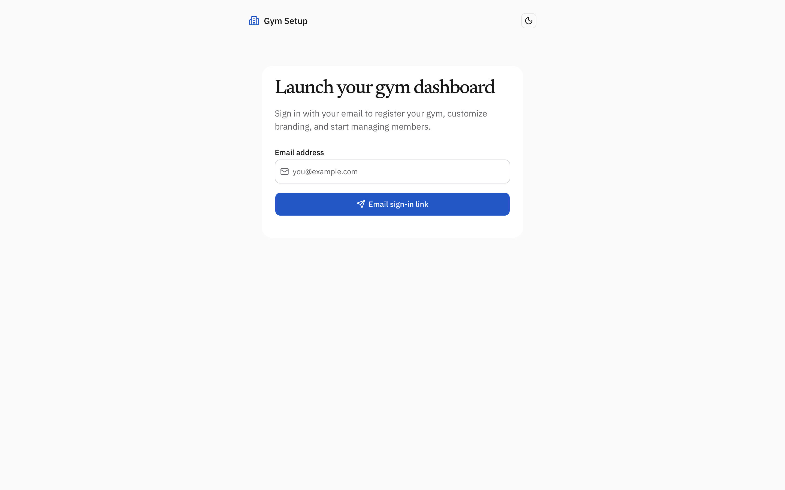
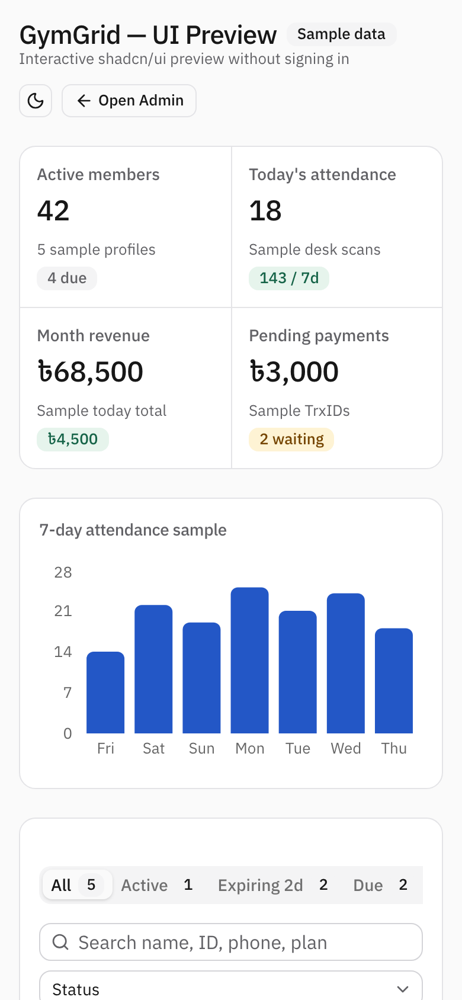

# GymGrid

Multi-tenant gym management workspace, QR desk check-in kiosk, and member portal designed for neighbourhood gyms in Bangladesh—replacing paper registers with bKash/Nagad `TrxID` payment reconciliation, tap-to-send WhatsApp renewal reminders, automated PDF receipts, and AI workout & diet plans.

Designed & built by [Ashraful Asif](https://ashrafulasif.vercel.app)

[](https://nextjs.org/)
[](https://react.dev/)
[](https://www.typescriptlang.org/)
[](https://tailwindcss.com/)
[](https://supabase.com/)
[](https://github.com/pmndrs/zustand)
[](https://greensock.com/)

---

## Overview & Key Features

GymGrid addresses the operational realities of neighbourhood gyms across Bangladesh: unmetered cash and mobile wallet payments (bKash & Nagad), manual paper ledger tracking, lost receipts, and irregular attendance. Built around the `Asia/Dhaka` timezone and Bangladeshi Taka (`৳` BDT), GymGrid operates with **zero third-party payment gateway fees** by combining direct peer-to-peer mobile payments with staff TrxID verification and automated workflows.

### 🏢 Owner & Front-Desk Operations (`/admin`, `/members`, `/add`, `/plans`, `/settings`, `/desk`, `/desk-qr`)
- **Today Operations Ledger (`/admin`):** Real-time monitoring of active memberships, today's attendance count, daily and monthly revenue in BDT, pending payments awaiting `TrxID` confirmation, memberships expiring within 48 hours, and "checked in without paying" alerts.
- **Mobile Wallet Reconciliation (`/admin`, `/members`):** Queue-based confirmation for bKash, Nagad, cash, and card payments. Atomic Postgres triggers compute plan dates, extend `expiry_date`, generate sequential receipt numbers, and queue PDF receipt generation in the background outbox.
- **Tap-to-Send WhatsApp Integration:** One-click prefilled `wa.me` links customized with member name, current plan, expiry date, and payment status—allowing staff to send personalized reminders in seconds without manual typing.
- **Live Reception Desk Feed (`/desk`):** Supabase Realtime broadcast screen designed for front-desk monitors, displaying real-time check-ins with immediate visual warnings for expired, due, or unpaid gym members.
- **Printable Desk QR Poster (`/desk-qr`):** Generates high-resolution scannable desk posters with cryptographically signed, rotatable check-in tokens (`checkin_qr_token()`, `rotate_checkin_token()`) preventing duplicate or off-site check-ins.
- **Customizable Branding & Member IDs (`/settings`, `/plans`):** Reusable plan packages, customizable member ID code formats (e.g. `MM-001`), gym logo upload, mobile wallet configurations, and custom AI provider credentials stored in Supabase Vault.

### 🏋️ Member Self-Service Portal (`/member`, `/checkin`, `/join`, `/join/[gymSlug]`, `/receipt`)
- **Passwordless Magic-Link Authentication:** Secure email OTP login linking authenticated users to their gym profile record via Postgres `claim_member()`.
- **In-Browser Camera QR Check-In (`/checkin`):** Camera-based scanner reads the gym's desk QR token, instantly recording attendance, tracking workout streaks, and updating a 14-day attendance pulse chart.
- **bKash & Nagad Renewal Submissions (`/member#pay`):** Displays the gym's official bKash/Nagad merchant or personal numbers and exact plan prices locked by Postgres triggers (`payments_guard()`), allowing members to submit their payment `TrxID` for instant staff review.
- **Digital PDF Receipts (`/receipt?id=...`):** Instant verification and download of official branded payment receipts backed by Supabase Storage.
- **AI Workout & Diet Generator (`generate-plan`):** Generates customized workout splits and nutrition targets verified against Mifflin-St Jeor calorie formulas, injury exclusions, and allergy constraints.

### ⚡ Automated Backend & Edge Architecture (`supabase/functions/` & `pg_cron`)
- **Outbox Dispatch Automation (`automation`):** Asynchronous `pg_cron` + `pg_net` background pipeline renders receipt PDFs to Supabase Storage (`receipts`), delivers SMTP confirmation emails, and synchronizes `Members` and `Payments` rows directly to Google Sheets.
- **Scheduled Morning Digests & Renewal Alerts:** Daily Dhaka-timezone cron passes notify members expiring within 48 hours via email (`reminder_log`) and deliver executive morning summaries (`owner_digest_for_gym`) to gym owners.

---

## Screenshots & Visual Tour

> **Note:** Authenticated staff and member views (`/admin`, `/members`, `/member`, `/desk`, `/desk-qr`) are showcased below using the public interactive demonstration route (`/preview`), populated with realistic sample data.

### Public Landing & Interactive Experience

| Centered Hero & Interactive Workbench (`1440×900`) | 30-Second Walkthrough Video & Chapters (`1440×900`) |
| :---: | :---: |
|  |  |
| *Editorial hero featuring the interactive 4-pane workbench (`HeroDesk.tsx`) displaying live check-in feed, pending TrxIDs, member pass, and WhatsApp renewals.* | *Embedded 30-second walkthrough video (`WalkthroughFilm.tsx`) detailing door QR scanning, desk sync, expired flag alerts, and bKash TrxID verification.* |

### Owner Operations & Member Management

| Admin Dashboard & KPI Ledger (`1440×900`) | Member Directory & DataTable (`1440×900`) |
| :---: | :---: |
|  |  |
| *Admin Today overview with neutral graphite color ramp, active member KPIs, today's attendance, monthly revenue, pending TrxIDs, and 7-day attendance pulse chart.* | *Filterable DataTable featuring live multi-column search, status chips (`Active`, `Due`, `Expired`), bKash/Nagad badges, and single-click WhatsApp action menus.* |

### Member Portal & Multi-Tenant Onboarding

| Member Self-Registration (`1440×900`) | Gym Owner Workspace Creation (`1440×900`) |
| :---: | :---: |
|  |  |
| *Member registration portal (`/join`) with OTP verification, emergency contact collection, and automated membership profile matching.* | *Multi-tenant onboarding wizard (`/onboarding`) allowing gym owners to configure gym name, slug, address, contact phone, and wallet credentials.* |

### Responsive Mobile Experience

| Mobile Landing View (`390×844`) | Mobile Operations Overview (`390×844`) |
| :---: | :---: |
|  |  |
| *Mobile-optimized landing page with adaptive typography, interactive feature drawers, and touch-first navigation.* | *Mobile admin dashboard stack with quick attendance counters, pending payment alerts, and mobile wallet reconciliation.* |

---

## Tech Stack

| Layer | Technology | Details |
| :--- | :--- | :--- |
| **Framework** | Next.js `16.4.6` (App Router, Turbopack) | Server Components, Route Handlers, Edge Runtime compatibility |
| **Runtime & Language** | React `19.3.1`, TypeScript `6.0.3` | Modern strict-mode TypeScript and React 19 primitives |
| **Styling & Design** | Tailwind CSS `v4.3.5`, `shadcn/ui` | Native CSS variables, Radix UI accessibility, custom neutral graphite palette |
| **Typography** | IBM Plex Sans, IBM Plex Mono, Noto Sans Bengali | Clear readability for operational tables, numerals, and bilingual English/Bengali UI |
| **Animation & Motion** | GSAP `3.15.1`, Lenis `1.3.28` | Smooth scroll transitions, scroll-triggered reveals, and reduced-motion fallbacks |
| **Data Visualization** | Recharts `3.8.0` | Responsive 7-day and 14-day attendance pulse charts with custom theme tooltip styling |
| **State Management** | Zustand `5.1.0` | Lightweight modular stores: `auth-store`, `gym-store`, `members-store`, `member-app-store`, `desk-store` |
| **Database & Auth** | Supabase (PostgreSQL 15+) | Multi-tenant Row Level Security (RLS), PKCE magic-link OTP authentication, Realtime broadcasts |
| **Storage & Secrets** | Supabase Storage & Supabase Vault | Branded receipt PDFs (`receipts`), gym logos (`gym-logos`), encrypted LLM API keys |
| **Edge Functions** | Deno Runtime | `ai-admin`, `generate-plan`, and `automation` (outbox processor) |
| **Testing & Tooling** | Node.js Test Runner (`node --test`), ESLint 9 | Native sub-millisecond unit test execution across frontend, lib, and Deno edge functions |

---

## Project Structure

```text
Gym/
├── app/                           # Next.js App Router routes & layouts
│   ├── (admin)/                   # Protected gym owner & staff workspace
│   │   ├── add/                   # Register new member manually
│   │   ├── admin/                 # Daily operational ledger & revenue metrics
│   │   ├── members/               # Comprehensive member directory & filters
│   │   ├── plans/                 # Membership packages & workout/diet templates
│   │   └── settings/              # Gym branding, mobile wallets & AI credentials
│   ├── (member)/                  # Member self-service portal
│   │   ├── join/ & join/[gymSlug] # Public self-registration & invite links
│   │   └── member/                # Multi-tab member PWA (Pass, Plans, Pay, History)
│   ├── api/health/route.ts        # GET /api/health monitoring endpoint
│   ├── auth/callback/route.ts     # Supabase PKCE auth code exchange & redirect guard
│   ├── checkin/page.tsx           # In-browser QR camera check-in scanner
│   ├── desk/ & desk-qr/           # Realtime front-desk monitor & printable scannable poster
│   ├── onboarding/page.tsx        # Multi-tenant gym workspace creation wizard
│   ├── preview/page.tsx           # Interactive demonstration preview with mock data
│   ├── receipt/page.tsx           # Branded public receipt PDF viewer & printer
│   ├── welcome/page.tsx           # Navigation hub for gym staff and members
│   ├── globals.css & landing.css  # Tailwind CSS v4 variables & custom keyframe animations
│   └── layout.tsx                 # Root layout, typography, theme provider & metadata
├── components/                    # Reusable React components
│   ├── admin/                     # Admin modals, MemberDialog, AiProvidersDialog
│   ├── landing/                   # HeroDesk, WalkthroughFilm, FAQ, and comparison cards
│   ├── member/                    # MemberPass, MemberPay, MemberReceipts, AiPlanDialog
│   └── ui/                        # Radix UI + Tailwind component library (shadcn/ui)
├── lib/                           # Core utilities, stores, and business logic
│   ├── stores/                    # Zustand stores (auth, gym, members, member-app, desk)
│   ├── supabase/                  # SSR and browser Supabase client factories & env validators
│   ├── logic.ts                   # Date math, BDT formatting, and attendance pulse computation
│   └── preview-data.ts            # Realistic fixture dataset for /preview demonstration
├── supabase/                      # Database configuration, migrations & functions
│   ├── config.toml                # Supabase local stack configuration & function JWT rules
│   ├── migrations/                # 31 SQL migrations (RLS, Triggers, Multitenancy, Vault, Cron)
│   ├── seed.sql                   # Starter gym data, membership plans, and members
│   ├── functions/                 # Deno Edge Functions
│   │   ├── _shared/               # Shared validation, Mifflin-St Jeor math, SSRF guards & tests
│   │   ├── ai-admin/              # Secure AI provider credentials management via Vault
│   │   ├── automation/            # Outbox dispatch (receipt PDFs, SMTP emails, Google Sheets sync)
│   │   └── generate-plan/         # LLM workout/diet plan generation with safety verification
│   └── tests/verify-db.mjs        # PGlite migration and RLS policy verification harness
├── docs/                          # Project documentation and screenshots
│   └── screenshots/               # High-resolution desktop and mobile UI screenshots
├── public/                        # Static assets, PWA manifest, and demo media
│   └── our-gym-qr-checkin.mp4    # 30-second walkthrough video
├── middleware.ts                  # Supabase session refresh & onboarding routing guards
└── next.config.ts                 # Security headers (HSTS, CSP, XFO), remote image patterns
```

---

## Prerequisites

- **Node.js** `20+` (verified and tested on **Node `v24.21.0`** and **npm `11.19.0`**)
- **Supabase Project** (Cloud instance or local Supabase CLI stack running PostgreSQL 15+, Auth, Storage, and Edge Functions)

---

## Getting Started

### 1. Clone the Repository & Install Dependencies

```bash
git clone https://github.com/Asif259/GymGrid.git
cd GymGrid
npm install
```

### 2. Configure Environment Variables

Create a `.env.local` file in the root directory by copying `.env.example`:

```bash
cp .env.example .env.local
```

#### Application Environment Variables (`.env.local`)

| Variable | Required | Description | Example |
| :--- | :---: | :--- | :--- |
| `NEXT_PUBLIC_SUPABASE_URL` | **Yes** | Your Supabase project URL | `https://your-project-ref.supabase.co` |
| `NEXT_PUBLIC_SUPABASE_PUBLISHABLE_KEY` | **Yes** | Supabase publishable (or anon) API key | `sb_publishable_...` |
| `NEXT_PUBLIC_GYM_NAME` | No | Fallback name used before gym branding loads (defaults to `GymGrid`) | `Powerhouse Fitness` |
| `NEXT_PUBLIC_DEFAULT_GYM_SLUG` | No | Fallback slug for legacy `/join` routes (defaults to `default-gym`) | `powerhouse-dhaka` |

#### Supabase Edge Function Secrets

When deploying Deno Edge Functions (`supabase functions deploy ...`), configure these secrets in your Supabase project:

| Secret | Function | Description |
| :--- | :--- | :--- |
| `AUTOMATION_SECRET` | `automation` | Shared secret matched against `x-automation-secret` header (also in Supabase Vault) |
| `SMTP_HOST`, `SMTP_PORT`, `SMTP_USER`, `SMTP_PASS`, `MAIL_FROM` | `automation` | SMTP credentials (defaults to port `465` TLS) for sending receipt PDFs and renewal emails |
| `GOOGLE_SERVICE_ACCOUNT_JSON` | `automation` | Service account JSON string used to mirror `Members` and `Payments` into Google Sheets |

> **Privacy & Security Note:** LLM API keys (Google Gemini or OpenAI-compatible providers) are entered securely by gym owners in `/settings` and stored directly in **Supabase Vault** (`app_vault_secrets`). They are never exposed to browser clients or committed into source control.

### 3. Run Database Migrations

Apply the 31 sequential migrations in `supabase/migrations/` using the Supabase CLI:

```bash
supabase db push
# Optional: Seed sample plans and members
supabase db reset
```

> **Note on `npm run verify:db`:** The test suite `npm run verify:db` validates schema logic against an in-process `@electric-sql/pglite` engine. Full storage policy verification requires standard Supabase cloud or local Supabase CLI instances where the `storage` schema is pre-provisioned.

### 4. Launch the Local Development Server

```bash
npm run dev
```

Visit [http://localhost:3000](http://localhost:3000) to view the landing page, or visit [http://localhost:3000/preview](http://localhost:3000/preview) to interact with the full administrative dashboard preview without needing live Supabase credentials.

---

## Available Scripts

| Command | Description |
| :--- | :--- |
| `npm run dev` | Starts the Next.js development server with Turbopack on port `3000` |
| `npm run build` | Compiles the production application bundle with typechecking and linting |
| `npm run start` | Runs the compiled Next.js production server |
| `npm run lint` | Analyzes code quality using ESLint 9 |
| `npm run typecheck` | Executes strict TypeScript compilation verification (`tsc --noEmit`) |
| `npm test` | Runs the full unit test suite (40 tests across frontend, Edge functions, and core logic) |
| `npm run verify:db` | Runs the in-memory PGlite database migration and RLS integrity tests |
| `npm run web` | Serves the standalone companion zero-build static app in `web/` on port `3000` |

---

## API & Edge Functions Reference

### Next.js Route Handlers
- **`GET /api/health`**: Readiness and healthcheck endpoint returning `{ ok: true, timestamp }` (`Cache-Control: no-store`).
- **`GET /auth/callback`**: Handles Supabase PKCE authentication code exchange, sets server-side session cookies, and safely redirects to validated relative paths.

### Supabase Edge Functions (`supabase/functions/`)
- **`POST /functions/v1/ai-admin`** (`verify_jwt = true`, owner role required):
  - Actions: `status`, `test`, `models`, `save`.
  - Securely validates and stores custom Google Gemini or OpenAI-compatible provider credentials in Supabase Vault.
- **`POST /functions/v1/generate-plan`** (`verify_jwt = true`, member JWT required):
  - Generates custom workout splits and calorie-balanced diet plans.
  - Enforces deterministic safety bounds: Mifflin-St Jeor caloric floors, maximum 500 kcal deficits, allergen filtering, and a strict 24-hour rate limit (1 workout plan and 1 diet plan per member per day).
- **`POST /functions/v1/automation`** (`verify_jwt = false`, secured via `x-automation-secret`):
  - `/automation/dispatch`: Processes outbox events (renders PDF receipts into Supabase Storage, sends SMTP receipts, syncs Google Sheets).
  - `/automation/reminders`: Dispatches renewal notification emails to members whose plans expire within 48 hours.
  - `/automation/digest`: Computes and emails the daily executive digest (`owner_digest_for_gym`) to gym owners.

---

## Security & Architecture Highlights

- **Multi-Tenant Row Level Security (RLS):** Every database table isolates records by `gym_id` with strict Postgres RLS policies preventing cross-tenant leakage. Owner and staff permissions are verified via helper functions (`is_gym_owner()`, `is_gym_staff()`).
- **SSRF Protection:** Outbound requests to user-defined LLM endpoints in `ai-admin` are strictly validated by `assertSafeBaseUrl()`, blocking loopback (`127.0.0.1`, `localhost`), link-local, private IP ranges (RFC 1918), and internal cloud metadata endpoints (`169.254.169.254`).
- **Cryptographic Desk Tokens:** Front-desk check-in QR codes use rotatable cryptographic tokens (`checkin_qr_token()`) rather than static links, preventing remote or unauthorized check-in replay attacks.
- **Enterprise Security Headers:** Configured in `next.config.ts` with strict HSTS (`max-age=63072000; includeSubDomains; preload`), `X-Frame-Options: SAMEORIGIN`, `X-Content-Type-Options: nosniff`, and `Referrer-Policy: strict-origin-when-cross-origin`.

---

## Deployment Guide

### Deploying the Frontend (Vercel)
1. Push your code to GitHub.
2. Import the repository into [Vercel](https://vercel.com).
3. Set the required environment variables in the Vercel dashboard:
   - `NEXT_PUBLIC_SUPABASE_URL`
   - `NEXT_PUBLIC_SUPABASE_PUBLISHABLE_KEY`
4. Deploy. Vercel automatically detects Next.js and builds the project with zero additional configuration.

### Deploying the Backend (Supabase)
1. Link your local project to your remote Supabase organization:
   ```bash
   supabase link --project-ref your-project-ref
   ```
2. Push all database migrations:
   ```bash
   supabase db push
   ```
3. Deploy Edge Functions:
   ```bash
   supabase functions deploy ai-admin --no-verify-jwt=false
   supabase functions deploy generate-plan --no-verify-jwt=false
   supabase functions deploy automation --no-verify-jwt=true
   ```
4. Set required function secrets in Supabase:
   ```bash
   supabase secrets set AUTOMATION_SECRET=your_secret_key
   supabase secrets set SMTP_HOST=smtp.example.com SMTP_PORT=465 SMTP_USER=user SMTP_PASS=pass MAIL_FROM="Gym <gym@example.com>"
   ```

---

## Contributing & License

Contributions, bug reports, and suggestions are welcome!

1. Fork the repository and create a feature branch (`git checkout -b feature/amazing-feature`).
2. Ensure all linting, typechecking, and tests pass:
   ```bash
   npm run lint && npm run typecheck && npm test
   ```
3. Commit your changes (`git commit -m 'Add amazing feature'`).
4. Push to your branch (`git push origin feature/amazing-feature`) and open a Pull Request.

### Author
Designed & built with precision by **[Ashraful Asif](https://ashrafulasif.vercel.app)**.

### License
This project is currently private and proprietary (`"private": true` in `package.json`). All rights reserved. For licensing or commercial inquiries, please contact the author.
