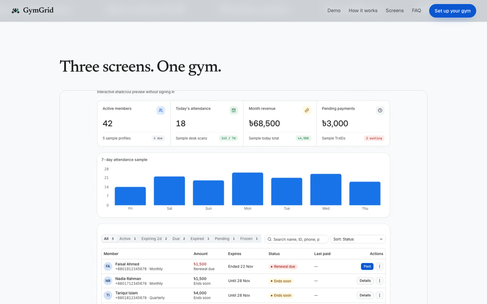
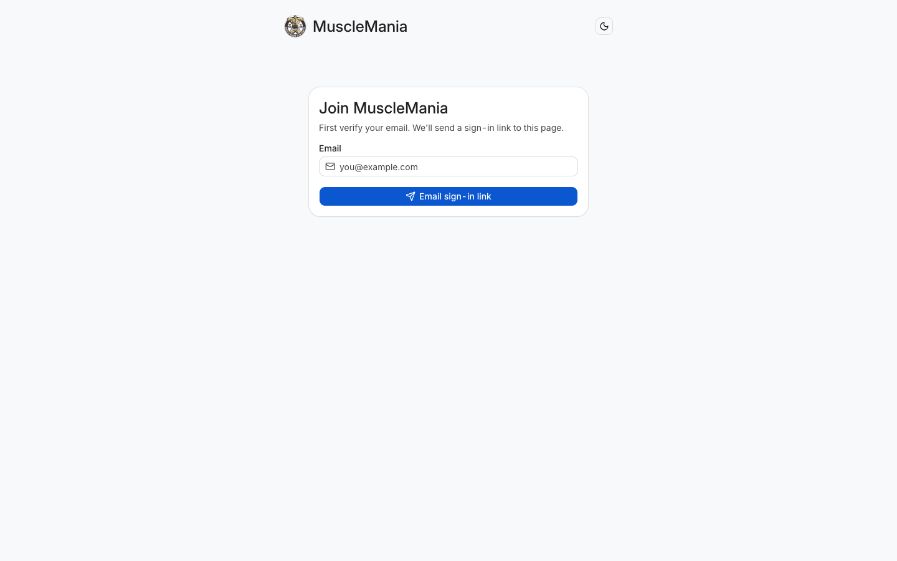
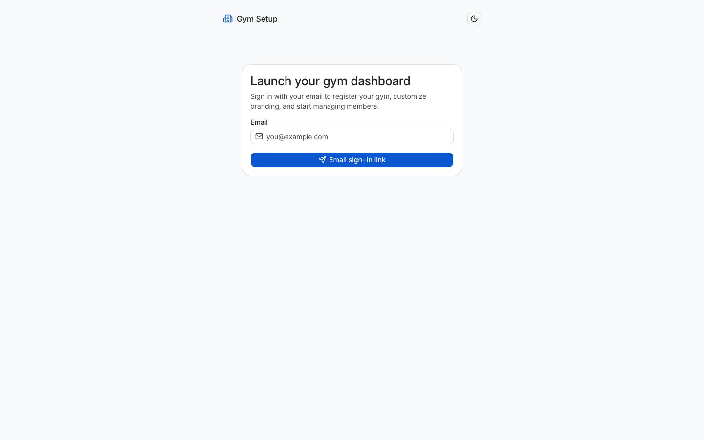
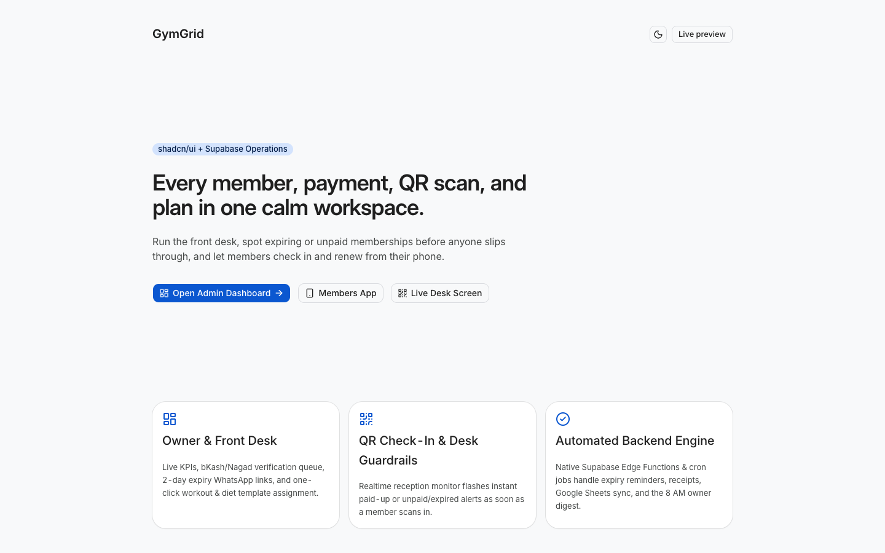
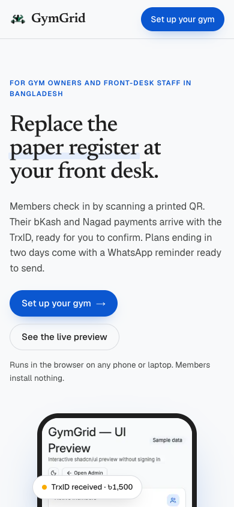

# GymGrid

Multi-tenant gym management workspace, QR desk check-in system, and member portal built for neighbourhood gyms in Bangladesh—replacing paper registers with bKash/Nagad `TrxID` verification, tap-to-send WhatsApp renewal reminders, automated receipts, and AI workout/diet plans.


---

## Overview & Key Features

GymGrid brings owner operations, front-desk reception verification, and mobile member self-service into one Material Design 3 workspace (`Asia/Dhaka` timezone, `৳` BDT currency, zero third-party payment gateway fees).

### Owner & Front-Desk Operations (`/admin`, `/members`, `/add`, `/plans`, `/settings`, `/desk`, `/desk-qr`)
- **Today Overview & KPI Ledger (`/admin`):** Tracks active members, today's check-ins, monthly/daily revenue, pending payments waiting on `TrxID` verification, expiring 48-hour renewals, and "checked in without paying" alerts.
- **Mobile Wallet Reconciliation (`/admin`, `/members`):** Confirms bKash, Nagad, cash, or card payments from a centralized queue; Postgres triggers automatically compute plan periods, extend member `expiry_date`, generate receipt numbers, and enqueue PDF receipt generation.
- **Tap-to-Send WhatsApp Reminders:** Generates prefilled `wa.me` renewal and receipt links tailored to each member's phone, plan, and expiry date.
- **Live Desk Screen & Printable QR Poster (`/desk`, `/desk-qr`):** Streams real-time check-ins over Supabase Realtime, flags expired or due memberships immediately on scan, and generates rotatable desk QR check-in tokens (`checkin_qr_token()`, `rotate_checkin_token()`).
- **Workout & Diet Templates + Multi-Tenant Branding (`/plans`, `/settings`):** Reusable plan templates, customizable member ID codes, gym branding upload (logo, phone, address, bKash/Nagad numbers), and owner-configured encrypted AI providers stored in Supabase Vault.

### Member Self-Service Portal (`/member`, `/checkin`, `/join`, `/join/[gymSlug]`, `/receipt`)
- **Passwordless Magic-Link Auth:** Email OTP sign-in automatically links authenticated accounts to matching `members` records via `claim_member()`.
- **QR Check-In & Streak Tracking (`/checkin`, `/member`):** Members scan the printed desk QR with their phone camera to record attendance, view streak metrics, and inspect a 14-day attendance pulse chart.
- **bKash / Nagad Renewal Submissions:** Displays the gym's wallet numbers and exact plan price locked by Postgres trigger (`payments_guard()`), letting members submit their `TrxID` for staff verification and download PDF receipts (`/receipt?id=...`).
- **AI Workout & Diet Plan Generator (`generate-plan`):** Generates personalized workout splits and nutrition plans checked against Mifflin-St Jeor calorie bounds, injury constraints, and allergens with rate limiting and provider failover.

### Automated Backend (`supabase/functions/`)
- **Outbox Dispatch (`automation`):** Asynchronous `pg_cron` + `pg_net` pipeline generates receipt PDFs to Supabase Storage (`receipts`), sends receipt emails via SMTP, and syncs `Members` & `Payments` tabs to Google Sheets.
- **Morning Owner Digest & 2-Day Renewal Emails:** Scheduled Dhaka-timezone cron passes email members expiring within 2 days (`reminder_log`) and deliver morning owner digests.

---

## Screenshots / Visual Tour

> Note: Routes requiring a live Supabase OTP staff or member session (`/admin`, `/member`, `/desk`, `/desk-qr`, `/receipt`) are represented here alongside the public UI preview (`/preview`) populated with realistic sample data.

### Landing Page & Interactive UI Preview

| Landing Hero (`1440×900`) | Three Screens Section (`1440×900`) |
| :---: | :---: |
|  |  |
| Editorial landing page with mobile KPI preview and TrxID/check-in highlights | Surfaces overview linking to Admin, Member Mobile Pass, and Live Desk |

### Workspace & Onboarding Flows


*Admin Dashboard UI Preview (`/preview`) showcasing the Material 3 KPI ledger, 7-day attendance bar chart, status filter tabs, search, sorting, and single-click actions.*

| Member Self-Signup (`/join`) | Multi-Tenant Onboarding (`/onboarding`) | Welcome Hub (`/welcome`) |
| :---: | :---: | :---: |
|  |  |  |

### Mobile Views (`390×844`)

| Mobile Landing (`390×844`) | Mobile Admin KPI Preview (`390×844`) |
| :---: | :---: |
|  |  |

---

## Tech Stack

| Layer | Technology |
| :--- | :--- |
| **Framework** | Next.js `16.4.6` (App Router, Turbopack), React `19.3.1`, TypeScript `6` |
| **Styling & UI** | Tailwind CSS `v4`, `shadcn/ui` (Radix UI primitives), Lucide React, Sonner |
| **Data Viz & Motion** | Recharts `3.8`, GSAP `3.15` + ScrollTrigger, Lenis `1.3` |
| **State Management** | Zustand `5.1` (`auth-store`, `gym-store`, `members-store`, `member-app-store`, `desk-store`) |
| **Backend & Database** | Supabase (PostgreSQL, Row-Level Security, Auth OTP, Realtime, Storage, Vault, `pg_cron`/`pg_net`) |
| **Edge Functions** | Deno (`ai-admin`, `generate-plan`, `automation`) |
| **QR & Utilities** | `qrcode`, Node built-in test runner (`node --test`), `@electric-sql/pglite` for DB migration testing |

---

## Project Structure

```text
Gym/
├── app/                         # Next.js App Router pages, layouts, and API routes
│   ├── (admin)/                 # Staff-protected routes: /admin, /members, /add, /plans, /settings
│   ├── (member)/                # Member portal & self-signup: /member, /join, /join/[gymSlug]
│   ├── api/health/route.ts      # GET /api/health readiness endpoint
│   ├── auth/callback/route.ts   # Supabase OAuth / OTP code exchange handler
│   ├── checkin/                 # Desk QR scan check-in flow
│   ├── desk/ & desk-qr/         # Live reception monitor & printable QR poster
│   ├── onboarding/              # Multi-tenant gym workspace onboarding
│   ├── preview/                 # Sample-data interactive dashboard UI preview
│   ├── receipt/ & welcome/      # Public receipt view & quick-navigation hub
│   ├── globals.css & landing.css
│   └── layout.tsx               # Root layout, Material 3 typography, ThemeProvider, metadata
├── components/                  # Shared shells, charts, tables, dialogs, and landing components
│   ├── admin/                   # Admin dialogs and Today overview client
│   ├── landing/                 # LandingShell & FAQ schema data
│   ├── member/                  # Member overview, plans, pay, visits, receipts, profile, AI dialog
│   └── ui/                      # Canonical shadcn/ui primitives
├── lib/                         # Business logic, Supabase clients/env helpers, Zustand stores
├── supabase/
│   ├── config.toml              # Edge Function JWT verification rules
│   ├── migrations/              # 29 SQL migrations (core schema, RLS, triggers, multi-tenancy, AI, cron)
│   ├── seed.sql                 # Sample gym plans, members, and payment records
│   ├── functions/               # Deno Edge Functions: ai-admin, generate-plan, automation (+ _shared)
│   └── tests/verify-db.mjs      # In-process PGlite migration, RLS, and trigger verification suite
├── web/                         # Companion zero-build static HTML/ESM app & logic unit tests
├── public/                      # Static icons, PWA manifest, screenshots, humans.txt, qr_demo.html
├── middleware.ts                # Supabase SSR session refresh & /onboarding route guard
└── next.config.ts               # Image domains, security headers, CSP for qr_demo iframe, redirects
```

---

## Prerequisites

- **Node.js** `20+` (verified locally with **Node `v24.21.0`** and **npm `11.19.0`**)
- **Supabase Project** (cloud project or local Supabase CLI stack for Auth, Postgres migrations, Vault, Storage, and Edge Functions)

---

## Getting Started

### 1. Clone & Install Dependencies

```bash
git clone https://github.com/Asif259/GymGrid.git
cd GymGrid
npm install
```

### 2. Configure Environment Variables

Copy `.env.example` to `.env.local` and fill in your Supabase credentials:

```bash
cp .env.example .env.local
```

#### Next.js App Environment Variables (`.env.local`)

| Variable | Required | Description | Example |
| :--- | :---: | :--- | :--- |
| `NEXT_PUBLIC_SUPABASE_URL` | **Yes** | Your Supabase project URL | `https://your-project-ref.supabase.co` |
| `NEXT_PUBLIC_SUPABASE_PUBLISHABLE_KEY` | **Yes** | Supabase publishable or anon key | `sb_publishable_...` |
| `NEXT_PUBLIC_GYM_NAME` | No | Fallback display name before gym branding loads (defaults to `GymGrid` in `lib/supabase/env.ts`) | `Our Gym` |
| `NEXT_PUBLIC_DEFAULT_GYM_SLUG` | No | Default slug used when redirecting legacy `/join` links (defaults to `default-gym`) | `default-gym` |

#### Supabase Edge Function Secrets (for `automation`, `ai-admin`, `generate-plan`)

Set these in Supabase (`supabase secrets set ...`) when deploying the Deno Edge Functions (`SUPABASE_URL`, `SUPABASE_ANON_KEY`, and `SUPABASE_SERVICE_ROLE_KEY` are injected automatically by Supabase):

| Secret | Used By | Description |
| :--- | :--- | :--- |
| `AUTOMATION_SECRET` | `automation` | Shared secret verified against the `x-automation-secret` header (also stored in Supabase Vault as `automation_secret`) |
| `SMTP_HOST`, `SMTP_PORT`, `SMTP_USER`, `SMTP_PASS`, `MAIL_FROM` | `automation` | SMTP credentials (`SMTP_PORT` defaults to `465` TLS) for payment receipts, 2-day renewal reminders, and owner morning digests |
| `GOOGLE_SERVICE_ACCOUNT_JSON` | `automation` | Service account JSON string for upserting `Members` and `Payments` rows into configured Google Sheets |

> Note: Gym-level LLM API keys (Google Gemini or OpenAI-compatible providers) are managed by gym owners inside `/settings` (`ai-admin` function) and encrypted in Supabase Vault rather than hardcoded as environment variables.

### 3. Apply Database Migrations & Seed Data

Apply the SQL files in `supabase/migrations/` in chronological order against your Supabase database (plus optionally `supabase/seed.sql` for sample plans, members, and payments), then verify migrations & RLS locally without a remote database using PGlite:

```bash
npm run verify:db
```

### 4. Start the Development Server

```bash
npm run dev
```

Open [http://localhost:3000](http://localhost:3000) for the landing page, or [http://localhost:3000/preview](http://localhost:3000/preview) to explore the admin dashboard UI without signing in.

---

## Available Scripts

| Command | Purpose |
| :--- | :--- |
| `npm run dev` | Start the Next.js development server on port `3000` |
| `npm run build` | Build the optimized Next.js production bundle |
| `npm run start` | Serve the production build |
| `npm run lint` | Run ESLint (`eslint .`) across the codebase |
| `npm run typecheck` | Run TypeScript typechecking (`tsc --noEmit`) |
| `npm test` | Run all Node unit tests across `web/*.test.mjs`, `supabase/functions/_shared/*.test.mjs`, and `lib/*.test.mjs` |
| `npm run verify:db` | Execute all non-cron SQL migrations + `seed.sql` in PGlite and verify triggers, constraints, and RLS |
| `npm run web` | Serve the standalone zero-build static HTML companion app in `web/` on port `3000` |

---

## API & Edge Functions Reference

### Next.js Route Handlers
- `GET /api/health` — Returns `{ ok: true, timestamp }` (`force-dynamic`).
- `GET /auth/callback` — Exchanges Supabase auth PKCE `code` for a session cookie and redirects safely to validated local `next` paths.

### Supabase Edge Functions (`supabase/functions/`)
- **`POST /functions/v1/ai-admin`** (`verify_jwt = true`, owner role required): `status`, `test`, `models`, and `save` actions for Google Gemini / OpenAI-compatible AI provider configuration stored in Supabase Vault.
- **`POST /functions/v1/generate-plan`** (`verify_jwt = true`, member JWT required): Generates verified AI workout or diet plans with deterministic safety checks, provider failover, and 24-hour rate limiting (`1` plan per kind per day).
- **`POST /functions/v1/automation`** (`verify_jwt = false`, requires `x-automation-secret`):
  - `POST /automation/dispatch` — Processes outbox events (PDF receipts in Storage, receipt email, Google Sheets sync).
  - `POST /automation/reminders` — Emails renewal links to members expiring in 2 days.
  - `POST /automation/digest` — Sends daily digest summaries (`owner_digest_for_gym`) to gym owners.

---

## Deployment

### Next.js Frontend (Vercel / Node Host)
1. Configure `NEXT_PUBLIC_SUPABASE_URL` and `NEXT_PUBLIC_SUPABASE_PUBLISHABLE_KEY` (plus optional `NEXT_PUBLIC_GYM_NAME` and `NEXT_PUBLIC_DEFAULT_GYM_SLUG`).
2. Run the verification suite before deploying:
   ```bash
   npm run typecheck && npm run lint && npm test && npm run build
   ```
3. Start with `npm run start` or deploy directly to Vercel (no custom `Dockerfile` or `vercel.json` is needed).

### Supabase Backend & Cron Setup
1. Push all migrations from `supabase/migrations/`.
2. Deploy Edge Functions matching `supabase/config.toml` (`ai-admin` and `generate-plan` with JWT verification; `automation` with `--no-verify-jwt`).
3. Populate Vault entries `automation_url` and `automation_secret` (see `supabase/migrations/20261126000019_automation_cron.sql`) along with Edge Function secrets (`AUTOMATION_SECRET`, SMTP credentials, and `GOOGLE_SERVICE_ACCOUNT_JSON`).

---

## Contributing & License

1. Fork or branch from `main`, keep changes covered by `npm test` and `npm run verify:db`, and verify `npm run typecheck && npm run lint && npm run build` passes before opening a PR.
2. **License:** No `LICENSE` file is currently included in this repository (`"private": true` in `package.json`). Contact the author for licensing or reuse inquiries.
